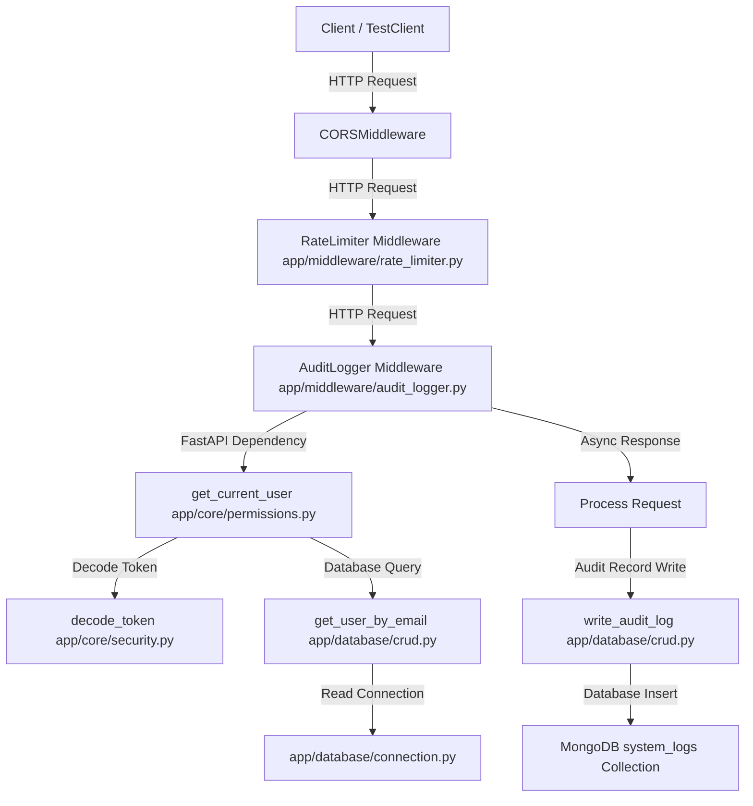

# System Knowledge Graph: Spam Email Detection System

## 1. Product Summary & High-Level Architecture
* **Product Name**: Spam Email Detection System (SaaS App)
* **Objective**: Detect suspicious emails using XGBoost, store records in MongoDB Atlas, and serve user insights via FastAPI backend + React/TS frontend.
* **Current State**: Phase 9 (Post-MVP Enhancements) and Final Verification Checklist completely finished. All frontend and backend tests pass. Code is deployment-ready.

---

## 2. Codebase Components

### 2.1 Backend Core & Utilities
* **Configuration Loader (`app/config.py`)**: Uses Pydantic Settings to load and validate configurations from `.env` files.
* **Structured Logger (`app/utils/logger.py`)**: Implements standard Python logging with a `JSONFormatter` to output structured logs to `stdout`.
* **Security & Tokens (`app/core/security.py`)**: Handles password hashing/validation via `bcrypt` and token signing/decoding via `PyJWT`.
* **RBAC & Dependencies (`app/core/permissions.py`)**: Provides OAuth2 token resolution dependencies (`get_current_user`) and RBAC checkers (`require_admin`, etc.).
* **Custom Exceptions (`app/core/exceptions.py`)**: Maps authentication, permission, and resource conflict scenarios to standard HTTP responses (401, 403, 409).

### 2.2 Database Management Layer
* **Connection Pool Manager (`app/database/connection.py`)**: Manages the lifecycle of the `pymongo` client, pooling connections, retry logic, and handling server selection pings.
* **Index Manager (`app/database/collections.py`)**: Verifies and provisions all 7 collections and 27 custom database indexes on application startup.
* **CRUD Database Helpers (`app/database/crud.py`)**: Implements direct database interactions for user collections and logs insertions.

### 2.3 API Routers
* **Health Check API (`app/api/health.py`)**: Exposes `GET /health` responding with system connectivity status.
* **Authentication Router (`app/api/auth.py`)**: Exposes `POST /auth/signup`, `POST /auth/login`, and `POST /auth/refresh` endpoints.
* **Admin Router (`app/api/admin.py`)**: Exposes admin-restricted endpoints like `GET /admin/users` (list users), `GET /admin/feedback` (list logged corrections), and `PATCH /admin/feedback/{feedback_id}` (approve/reject corrections, asynchronously triggering automated retraining if approved pool $\ge 10$).
* **Predict Router (`app/api/predict.py`)**: Exposes `POST /predict` endpoint, analyzing and classifying emails.
* **Feedback Router (`app/api/feedback.py`)**: Exposes `POST /feedback` endpoint for users to submit predictions corrections.
* **Analytics Router (`app/api/analytics.py`)**: Exposes `GET /analytics` endpoint returning aggregated system metrics.
* **History Router (`app/api/history.py`)**: Exposes `GET /history` endpoint returning paginated scan records.

### 2.4 Middlewares
* **Rate Limiter (`app/middleware/rate_limiter.py`)**: Configures `slowapi` targeting client IP addresses to restrict access frequency.
* **Audit Logger (`app/middleware/audit_logger.py`)**: Automatically intercepts critical API operations and records access events to the `system_logs` collection.

### 2.5 ML Preprocessing & Data Ingestion
* **Content Hashing (`app/utils/hashing.py`)**: Computes SHA-256 signatures of emails (`subject + body`) for deduplication checks.
* **NLP Preprocessor (`app/ml/preprocessor.py`)**: Cleans raw email/HTML payloads (removes tag markups, normalizes accented unicodes/whitespace, tokenizes/lemmatizes via spaCy, and preserves negation terms).
* **Ingestion Pipeline (`scripts/ingest_data.py`)**: Scans local email sources, cleans raw messages, hashes contents to bypass duplicates, splits data into train/val/test splits (70/15/15), bulk inserts records, and registers catalog stats in `dataset_metadata`.
* **Fetch Scripts (`scripts/fetch_spamassassin.py`, `fetch_enron.py`, `fetch_phishtank.py`)**: Automates raw dataset downloads and layouts with built-in `--mock` offline generation flags.
* **Model Training Engine (`app/ml/training.py`)**: Orchestrates the progressive fitting of Multinomial Naive Bayes, Logistic Regression, and XGBoost. Features threshold optimization, metrics exports, and `retrain_model_from_feedback()` which combines original training data with approved feedback corrections to train and hot-swap active models.
* **Training Script CLI (`scripts/train_models.py`)**: Main execution CLI entrypoint that boots MongoDB connections, fits feature vectorizers and progressive model networks, runs threshold optimizations, dumps model artifacts under `models/v1.0.0/`, and registers metrics documents.

### 2.6 Inference & Analytics Services
* **Inference Engine (`app/ml/inference.py`)**: Predicts spam likelihood, derives threat risk bands, and extracts TF-IDF feature contribution mappings (explainability factor maps).
* **Model Loading Service (`app/services/model_service.py`)**: Queries database for deployed configurations, lazy loads vectorizers/models, and caches the engine instance.
* **Prediction Service (`app/services/prediction_service.py`)**: Orchestrates inference flows, resolves unique content hashing checks to deduplicate email writes, integrates URL threat reputation scans, and runs joined aggregation scan queries.
* **Feedback Service (`app/services/feedback_service.py`)**: Validates prediction ownership limits, structural parameters, stores correction records, and supports list/patch status operations.
* **Threat Intelligence Service (`app/services/threat_intel.py`)**: Runs heuristics checking links against pattern lists (e.g. Netflix, PayPal scams) and caches results in `threat_intel_cache` with a 24-hour TTL.
* **Analytics Service (`app/services/analytics_service.py`)**: Uses aggregation frameworks to calculate scan volumes, spam rate, false-positive metrics, daily trends, and top offender domains.

### 2.7 Frontend Application
* **Vite Scaffolding & Config (`frontend/`)**: React + TS development environment with Vitest unit tests, Tailwind CSS v4, and Sentry client error monitoring.
* **State & API client (`frontend/src/services/apiClient.ts`, `contexts/AuthContext.tsx`)**: Integrates JWT local state management, silent token refresh queues on 401, and `/health` checkers.
* **Component System & Views (`frontend/src/components/`, `pages/`)**: Standardized layouts, forms (EmailForm), prediction elements (PredictionCard), and 8 custom pages (Dashboard, Analyze, History, Feedback, Analytics, Admin, Login, Signup) enforcing RBAC security blocks.

### 2.8 Deployment & Orchestration
* **Multi-stage Containers (`backend/Dockerfile`, `frontend/Dockerfile`)**: Compact runner images using Python virtual environments, pre-downloaded spaCy models, and static Nginx servers.
* **SPA Routing configuration (`frontend/nginx.conf`)**: Enables single-page web console page reloads fallback and gzip compression.
* **Service Orchestrations (`docker-compose.yml`, `render.yaml`)**: Composes MongoDB, FastAPI, and Nginx instances locally and defines production-ready deployment blueprints.

### 2.9 Operational Dashboard Console
* **Streamlit Admin Console (`backend/scripts/streamlit_app.py`)**: Standalone Streamlit application displaying operational volume stats, daily scan trend charts, top flagged sender domains, retraining progress gauges, and historical model performance registries.

---

## 3. Database Collections & Index Strategy
* **Database Name**: `phishing_detection_db` (Production/Development), `phishing_detection_test_db` (Testing)
* **Total Collections**: 7
* **Total Indexes**: 27 Custom + 7 Default `_id` = 34 Indexes

### 3.1 Schemas & Custom Indexes
1. **`users`**: User records and roles.
   * `idx_users_email` (unique): `email` ASC
   * `idx_users_user_id` (unique): `user_id` ASC
   * `idx_users_role`: `role` ASC
2. **`emails`**: Submissions and training datasets.
   * `idx_emails_email_id` (unique): `email_id` ASC
   * `idx_emails_created_at`: `created_at` DESC
   * `idx_emails_sender_domain`: `sender_domain` ASC
   * `idx_emails_dataset_source`: `dataset_source` ASC
   * `idx_emails_split`: `split` ASC
   * `idx_emails_label`: `label` ASC
   * `idx_emails_content_hash` (unique): `content_hash` ASC
3. **`predictions`**: ML outputs.
   * `idx_predictions_prediction_id` (unique): `prediction_id` ASC
   * `idx_predictions_email_id`: `email_id` ASC
   * `idx_predictions_model_version`: `model_version` ASC
   * `idx_predictions_created_at`: `created_at` DESC
   * `idx_predictions_user_id`: `user_id` ASC
4. **`feedback`**: User corrections on classifications.
   * `idx_feedback_feedback_id` (unique): `feedback_id` ASC
   * `idx_feedback_prediction_id`: `prediction_id` ASC
   * `idx_feedback_user_id`: `user_id` ASC
   * `idx_feedback_status`: `status` ASC
5. **`model_metadata`**: Serialized model records.
   * `idx_model_version` (unique): `model_version` ASC
   * `idx_model_deployed`: `deployed` ASC
6. **`dataset_metadata`**: Upload datasets meta registry.
   * `idx_dataset_id` (unique): `dataset_id` ASC
   * `idx_dataset_name`: `name` ASC
   * `idx_dataset_source`: `source` ASC
   * `idx_dataset_ingestion_date`: `ingestion_date` DESC
7. **`system_logs`**: System audit trailing events.
   * `idx_logs_log_id` (unique): `log_id` ASC
   * `idx_logs_event_type`: `event_type` ASC
   * `idx_logs_timestamp`: `timestamp` DESC
   * `idx_logs_severity`: `severity` ASC
   * `idx_logs_ttl` (TTL 90 days): `timestamp` ASC (expires after 7,776,000 seconds)

---

## 4. Current State & Next Steps
* **Completed**: Phase 1 (Project Foundation), Phase 2 (Authentication & Security), Phase 3 (Data Pipeline), Phase 4 (Feature Engineering), Phase 5 (ML Training & Evaluation), Phase 6 (Inference & API Endpoints), Phase 7 (Frontend Application), Phase 8 (Dockerization, Deployment & Monitoring), and Phase 9 (Post-MVP Enhancements).
* **Recent Milestones**: Built and deployed all Docker containers (`spam_detection_backend` on 8000, `spam_detection_frontend` on 3000, `spam_detection_db` on 27018) via `docker-compose`. Verified full frontend production rebuild with updated theme components. Streamlit Admin Console verified running on port 8501. Configured robust `run.bat` orchestration script with daemon checks, virtualenv resolution, and automatic browser launching. Verified API authentication and prediction endpoints end-to-end.
* **Next Target**: Codebase fully tested, containerized, and verified. Ready for remote staging deployment and production release audits.

